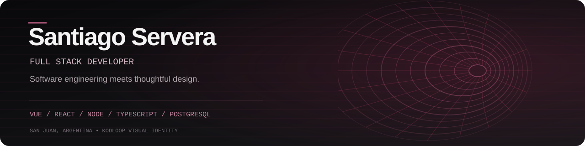

 

**Full Stack Developer · Software Engineering · Modern Web Experiences**

Desarrollo aplicaciones web y sistemas de gestión donde la ingeniería y el diseño se encuentran.

 

<a href="https://portfolio-santiago-servera.vercel.app/">Portfolio</a> &nbsp;·&nbsp;
<a href="https://www.linkedin.com/in/santiago-servera/">LinkedIn</a> &nbsp;·&nbsp;
<a href="mailto:santiagoservera21@gmail.com">Email</a>

---

### Sobre mí

Soy **Santiago Servera**, desarrollador Full Stack de San Juan, Argentina. Me especializo en construir aplicaciones web, sistemas de gestión y soluciones digitales para necesidades reales.

Actualmente trabajo principalmente con **Vue.js, Node.js y Express**. También tengo experiencia con **React y TypeScript**, y he trabajado anteriormente con **Angular**. Me interesa tanto lo que sucede detrás de una aplicación como la experiencia de quien la utiliza: interfaces modernas, arquitectura clara y código mantenible.

En mi forma de trabajar incorporo herramientas de desarrollo asistido por IA y prácticas como **Spec-Driven Development (SDD)**, manteniendo siempre el criterio técnico sobre las decisiones y el resultado.

### Stack tecnológico

**Lenguajes y frontend**

  

**Backend, datos y herramientas**

  

También trabajo con **SQL Server** y herramientas de colaboración como **Jira, Slack, Notion y Trello**.

### Proyectos destacados

| Proyecto | Descripción | |
| :--- | :--- | :--- |
| **[MotorOS](https://motoros.tech/)** | Plataforma de gestión para concesionarias: inventario, clientes, leads, reservas, ventas y procesos comerciales. | [Visitar ↗](https://motoros.tech/) |
| **[Di Parola Automotores](https://diparolaautomotores.com/)** | Experiencia web para una concesionaria automotriz, enfocada en su identidad, vehículos y presencia digital. | [Visitar ↗](https://diparolaautomotores.com/) |

### Mi enfoque

- **Producto y experiencia:** soluciones útiles, interfaces actuales y atención a los detalles.
- **Ingeniería:** arquitectura modular cuando aporta valor, mantenibilidad y reducción de deuda técnica.
- **Proceso:** entender los requisitos antes de implementar, iterar y validar.
- **IA aplicada al desarrollo:** utilizarla como herramienta de apoyo, no como sustituto del criterio técnico.

### Actualmente explorando

Estoy profundizando en **RAG**, **Model Context Protocol (MCP)**, **agentes de IA** y **bases de datos vectoriales / pgvector**. Son áreas de aprendizaje y experimentación, no especialidades que pretenda presentar como experiencia profesional consolidada.

---

**¿Trabajamos juntos?**

Estoy abierto a oportunidades para construir productos y experiencias digitales.

[**LinkedIn**](https://www.linkedin.com/in/santiago-servera/) · [**Portfolio**](https://kodloop.com) · [**Email**](mailto:santiagoservera21@gmail.com)

Diseño e ingeniería con atención a los detalles.

